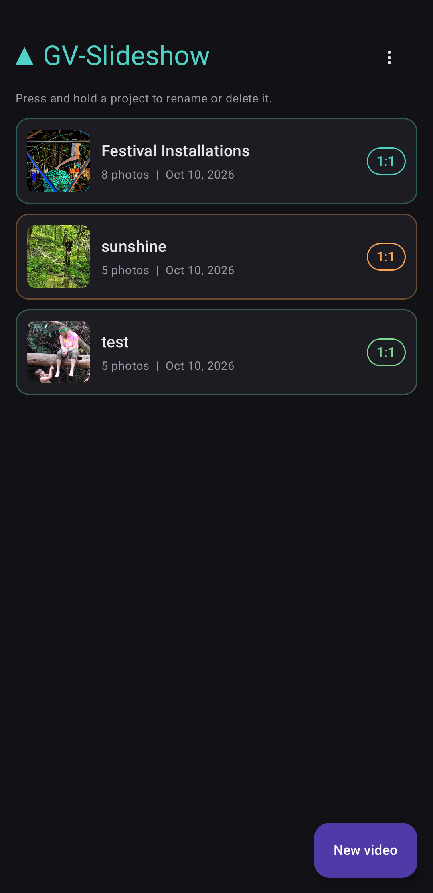
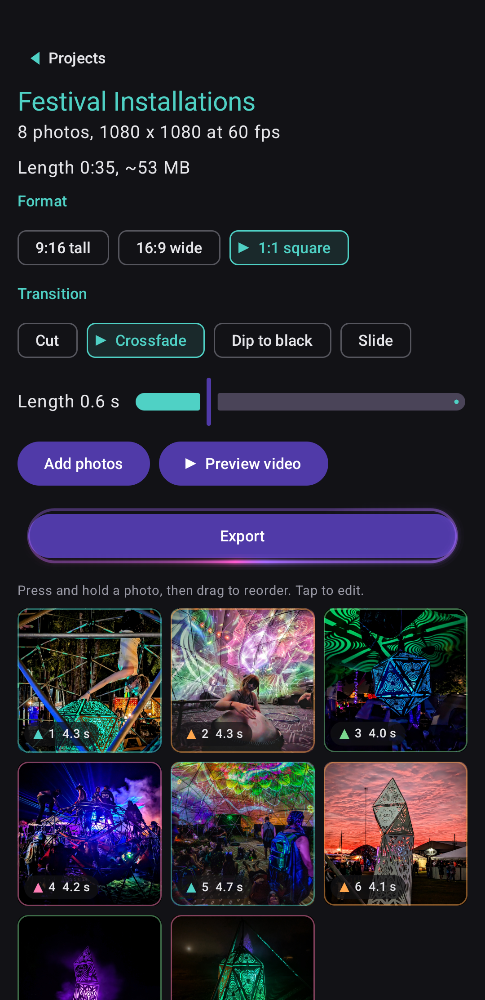
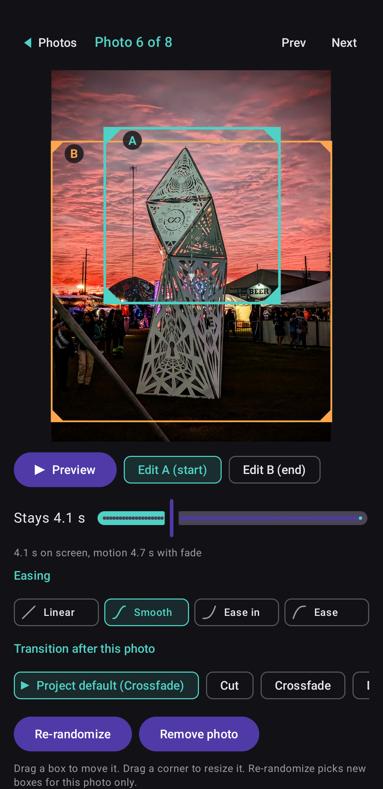
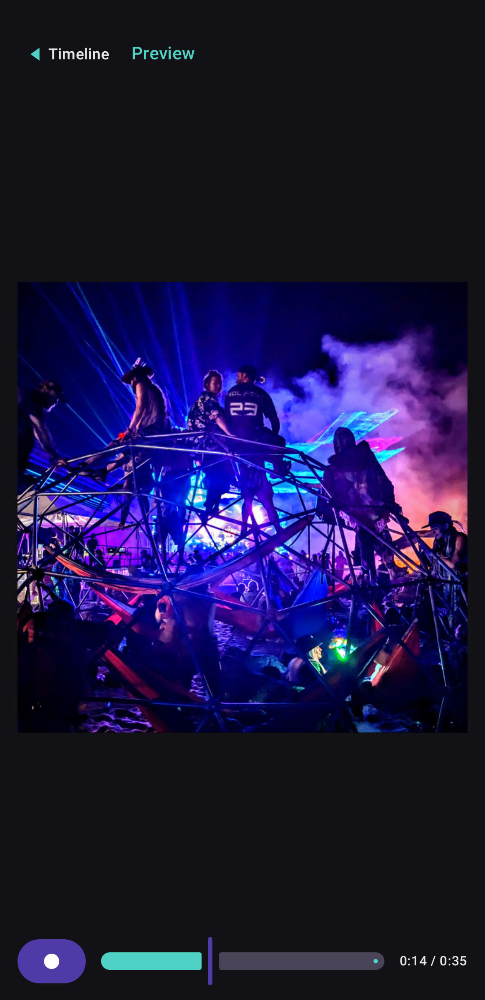

# GV-Slideshow

Pick photos on your Android phone and GV-Slideshow turns them into an MP4 with the Ken Burns effect, a slow pan and zoom across each photo. Every photo gets a random start and end framing, and if there are faces in the shot the move centers on them (push in, pull out, or hold them in frame, picked at random, and group shots keep everyone in view). Then you can fine-tune each move however you want. I build LED installations for a living and wanted a quick way to turn event and install photos into motion clips right on my phone, with real control over each move. I couldn't find an app that did it the way I wanted, so I built it.

## Features

- Video shapes 9:16, 16:9, 1:1. 1080p, 60 fps, H.264 MP4. Silent for now (no audio yet)
- Transitions: cut, crossfade, dip to black, slide (push). Set a project-wide default, override per photo, and adjust the transition length (default 0.6 s)
- Per-photo editor: drag and resize the start (A) and end (B) frames, locked to the video's shape. Duration 2 to 10 s per photo, 4 easing curves, a re-randomize button, and a live motion preview
- Full slideshow preview before you export
- Saved projects, drag to reorder photos
- Export runs in the background with a progress notification. Videos land in Movies/GV-Slideshow, and you see the estimated size and length before you commit
- Face detection runs on the device, offline, once per photo at import. No accounts, no network use, no tracking

## Screenshots

<p>
  
  
  
  
</p>

## Install

Needs Android 13 (API 33) or newer.

Grab the APK from [GitHub Releases](https://github.com/balgarath/gv-slideshow/releases) and sideload it (you'll need to allow installs from your browser or files app). Or build it yourself, see below.

## Build from source

You need JDK 21 and an Android SDK with platform 36.

```
./gradlew :core:test :app:assembleDebug
```

That runs the unit tests and gives you a debug APK.

Release signing reads an optional `keystore.properties` file in the repo root (`storeFile`, `storePassword`, `keyAlias`, `keyPassword`, see `keystore.properties.example`). Without it, release builds fall back to debug signing.

`:core` is a pure Kotlin module with the framing math, the timeline, and the project format, covered by JVM unit tests.

## How it works

Kotlin and Jetpack Compose for the app. Rendering is AndroidX Media3 Transformer with a custom GL shader that does the pan, zoom, and transitions. Face detection is Google ML Kit with the bundled model, so it works offline. Reorderable lists come from sh.calvin.reorderable.

One note on licensing: ML Kit face detection is free to use but closed source, distributed under Google's ML Kit Terms of Service. The rest of the dependencies are Apache-2.0, and the app's own code is MIT.

## Status

This is a personal tool and it works well on my Pixel. Ideas for later: a music track, titles and text overlays. Issues and PRs welcome.

## Credits and license

Built by Ralph Edge / Geovisual Creations. MIT licensed, see [LICENSE](LICENSE).
